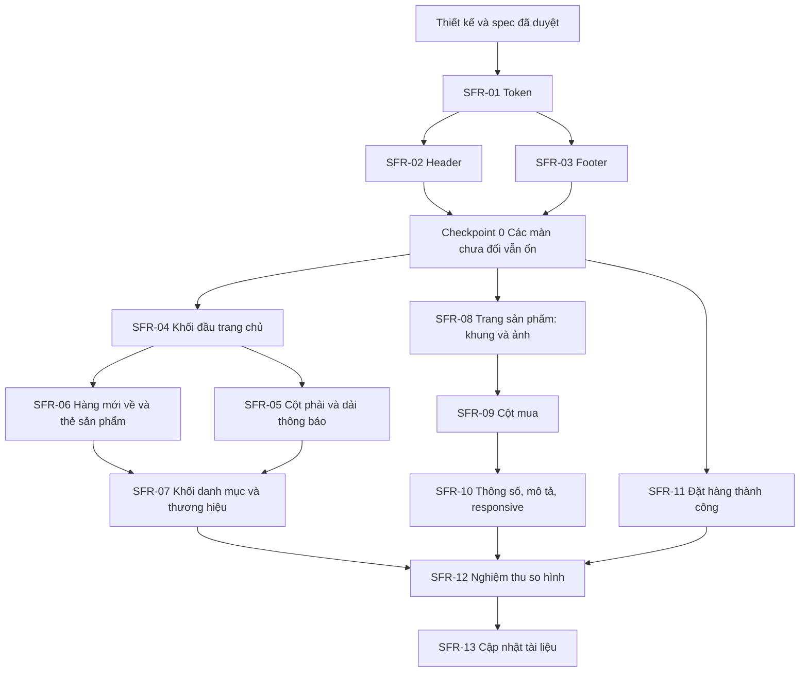

# Implementation Plan: storefront-redesign

> Status: v1, soạn ngày 2026-11-24, chờ duyệt.
> Spec: `spec/SPEC-storefront-redesign.md`, đã duyệt.
> Thiết kế: `design/README.md`, `design/screens/`, `design/token.css`.

## Tóm tắt

Plan này đưa bản thiết kế mới của trang chủ, trang sản phẩm và trang đặt hàng thành công vào code. Chỉ đổi giao diện, không đổi API hay luồng đặt hàng.

Công việc chia thành bốn Phase. Phase 0 làm nền chung: token mới, header, footer. Phase 1 dựng trang chủ. Phase 2 dựng trang sản phẩm. Phase 3 dựng trang đặt hàng thành công. Cuối cùng là nghiệm thu bằng so hình ở ba cỡ màn hình.

Mỗi task nhỏ hơn một buổi làm và để ứng dụng build, test được. Các màn chưa có thiết kế mới (danh mục, giỏ hàng, thanh toán, tài khoản) giữ nguyên, nhưng vẫn dùng header và footer mới, nên Checkpoint 0 kiểm riêng chúng.

## Overview

Mỗi màn có ba cỡ: máy tính 1440px, máy tính bảng 768px, điện thoại 375px. Trang đặt hàng thành công chỉ có hai cỡ, cỡ 768px dùng bố cục máy tính co lại.

Các câu hỏi mở của spec chưa được chốt. Plan tạm theo đề xuất bên dưới, đổi khi người dùng quyết khác:

- Banner nổi bật có một tab cho mỗi danh mục gốc, hiện sản phẩm mới nhất của danh mục đó.
- Cột "Mới lên kệ" lấy ba sản phẩm mới nhất của toàn cửa hàng.
- Logo hãng hiện bằng tên chữ như thiết kế, vì API trả `logoUrl` null.
- Không có giảm giá và đánh giá trên thẻ sản phẩm.
- Thanh mua cố định chưa làm.
- Trang sản phẩm ở 768px là một cột.
- So hình bằng mắt kèm kiểm tra không có thanh cuộn ngang, không so từng pixel.

## Architecture Decisions

- Token mới đặt vào `tokens.css` ở Phase 0 để các task sau chỉ dùng biến. Test `css-colors.test.ts` vẫn chặn mã màu cứng.
- Mốc 768px và 1200px ghi thẳng trong media query kèm chú thích. CSS không đọc được biến cho media query.
- Chỉ đổi mốc breakpoint trong file CSS thuộc ba màn. Không dọn các mốc 767, 1023, 1199 ở màn khác.
- Dùng lại hook dữ liệu hiện có (`useCategoryTree`, `useRailProducts`, `useCategorySummary`, hook của trang sản phẩm và đơn hàng). Không gọi API mới.
- Header và footer là phần của `CustomerLayout`, nên đổi một lần cho mọi màn khách.
- Dùng lại `category-menu.tsx` cho menu danh mục. Cột trái trang chủ là bản liệt kê tĩnh cùng nguồn dữ liệu.
- Ảnh trong suốt của banner nổi bật và ba banner nhỏ đi qua `withCloudinaryTransform`. Việc tách nền xảy ra trên ảnh đã tải lên, không trong code.
- Giữ nguyên logic nghiệp vụ trong `variant-selection.ts`, `order-next-steps.ts`, `order-success-link.ts`. Chỉ đổi phần hiển thị.

## Dependency Graph



Phase 1, 2 và 3 độc lập sau Checkpoint 0, nên có thể giao cho các phiên builder song song, mỗi phiên một worktree.

## Task List

### Phase 0: Nền chung

- [x] SFR-01: Thêm token mới vào `tokens.css`. Cỡ S.
- [x] SFR-02: Header hai tầng và bản điện thoại. Cỡ M.
- [x] SFR-03: Footer bốn cột. Cỡ S.

### Checkpoint 0

- [ ] `pnpm typecheck`, `pnpm lint`, `pnpm test` pass.
- [ ] Chụp danh mục, giỏ hàng, thanh toán, tài khoản, tra cứu đơn với header và footer mới ở 1440, 768, 375px. Không vỡ bố cục.
- [ ] `customer-header-mobile.spec.ts` pass.

### Phase 1: Trang chủ

- [ ] SFR-04: Menu danh mục, banner nổi bật có tab, ba banner nhỏ. Cỡ M.
- [ ] SFR-05: Cột phải (Mới lên kệ, Mua theo thương hiệu, gợi ý so sánh) và dải thông báo phí giao hàng. Cỡ M.
- [ ] SFR-06: Hàng mới về và thẻ sản phẩm mới. Cỡ M.
- [ ] SFR-07: Năm khối danh mục, thương hiệu nổi bật, responsive 768 và 375px. Cỡ L.

### Checkpoint 1

- [ ] Trang chủ khớp ba ảnh `trang-chu-*`.
- [ ] Không thanh cuộn ngang ở 1440, 768, 375px.
- [ ] Test và e2e của trang chủ pass. Review với người dùng.

### Phase 2: Trang sản phẩm

- [ ] SFR-08: Khung hai cột, tiêu đề, thư viện ảnh. Cỡ M.
- [ ] SFR-09: Cột mua (giá, bộ nhớ, màu, số lượng, nút mua, chính sách). Cỡ M.
- [ ] SFR-10: Cam kết, thông số, mô tả, sản phẩm cùng danh mục, responsive. Cỡ M.

### Checkpoint 2

- [ ] Trang sản phẩm khớp ba ảnh `san-pham-*`.
- [ ] Chọn biến thể, biến thể hết hàng, sản phẩm ngừng kinh doanh hoạt động như cũ.
- [ ] `catalog-product-page.spec.ts` pass. Review với người dùng.

### Phase 3: Đặt hàng thành công

- [ ] SFR-11: Thẻ xác nhận, sản phẩm, timeline, cột tóm tắt, responsive. Cỡ M.

### Checkpoint 3

- [ ] Khớp hai ảnh `dat-hang-thanh-cong-*`.
- [ ] `commerce-checkout.spec.ts` pass. Có video luồng đặt hàng và ảnh hai cỡ.

### Phase 4: Nghiệm thu

- [ ] SFR-12: Spec so hình và kiểm tra cuộn ngang cho ba màn. Cỡ S.
- [ ] SFR-13: Cập nhật `design/README.md`, `tasks/README.md`, ghi ngày xong. Cỡ S.

### Checkpoint cuối

- [ ] Các tiêu chí của spec có bằng chứng.
- [ ] `pnpm typecheck`, `pnpm lint`, `pnpm test`, `pnpm test:e2e` pass.
- [ ] Review với người dùng trước khi sang các màn còn lại.

## Phạm vi từng task

| Task | Files chính | Verify | Cỡ |
|---|---|---|---|
| SFR-01 | `tokens.css`, test token | Unit test token và màu cứng | S |
| SFR-02 | `header.tsx`, `header.css`, `category-menu.tsx`, test header | Unit, `customer-header-mobile.spec.ts` | M |
| SFR-03 | `footer.tsx`, `footer.css`, test footer | Unit, ảnh chụp | S |
| SFR-04 | `home-page.tsx`, `banner-carousel.tsx`, `promo-banners.tsx`, `home-page.css` | Unit, ảnh chụp ba cỡ | M |
| SFR-05 | `home-page.tsx`, `home-queries.ts`, `home-page.css`, file cột phải mới | Unit, ảnh chụp | M |
| SFR-06 | `product-card.tsx`, `product-card.css`, `product-grid.tsx`, `home-page.css` | Unit, ảnh chụp | M |
| SFR-07 | `home-page.tsx`, `home-page.css`, `home-page.test.tsx`, e2e trang chủ | Unit, e2e, ảnh chụp | L |
| SFR-08 | `product-view.tsx`, `product-gallery.tsx`, `product-page.css` | Unit, ảnh chụp | M |
| SFR-09 | `variant-picker.tsx`, `product-view.tsx`, `add-to-cart-button.tsx`, `product-page.css` | Unit, e2e chọn biến thể | M |
| SFR-10 | `spec-table.tsx`, `description-view.tsx`, `product-page.css`, `catalog-product-page.spec.ts` | Unit, e2e, ảnh chụp ba cỡ | M |
| SFR-11 | `order-success-page.tsx`, `order-sections.tsx`, `checkout-page.css`, `commerce-checkout.spec.ts` | Unit, e2e, video | M |
| SFR-12 | spec so hình mới, helper chụp | `pnpm test:e2e` | S |
| SFR-13 | `design/README.md`, `tasks/README.md` | Đọc lại | S |

SFR-07 là cỡ L vì gom năm khối cùng một mẫu, thêm responsive và sửa test. Nếu vượt quá một buổi thì tách khối thương hiệu và responsive thành task riêng.

## Ảnh thiết kế theo task

| Task | Ảnh trong `design/screens/` |
|---|---|
| SFR-01 | `design/token.css` |
| SFR-02, SFR-03 | Đầu và cuối của ba ảnh `trang-chu-*` |
| SFR-04 đến SFR-07 | `trang-chu-may-tinh-1440.png`, `trang-chu-may-tinh-bang-768.png`, `trang-chu-dien-thoai-375.png` |
| SFR-08 đến SFR-10 | `san-pham-may-tinh-1440.png`, `san-pham-may-tinh-bang-768.png`, `san-pham-dien-thoai-375.png` |
| SFR-11 | `dat-hang-thanh-cong-may-tinh-1440.png`, `dat-hang-thanh-cong-dien-thoai-375.png` |
| SFR-12 | Cả 8 ảnh |

Từng task trong `todo.md` có dòng "Màn hình" nói task làm phần nào của ảnh, rồi liệt kê đường dẫn ảnh chuẩn.

## Verification Commands

Chạy từ `apps/frontend/`:

```powershell
pnpm typecheck
pnpm lint
pnpm test
pnpm test:e2e
```

So hình: mở `pnpm dev`, đặt cửa sổ rộng 1440, 768 và 375px, so với `design/screens/`.

## Traceability

| Tiêu chí của spec | Task và checkpoint |
|---|---|
| Bố cục khớp ảnh ở ba cỡ | SFR-04 đến SFR-11, Checkpoint 1, 2, 3, SFR-12 |
| Không thanh cuộn ngang | SFR-07, SFR-10, SFR-11, SFR-12 |
| Không mã màu cứng, `css-colors.test.ts` pass | SFR-01 và mọi task có CSS |
| Hành vi cũ còn nguyên | SFR-09, SFR-10, SFR-11, Checkpoint 2 và 3 |
| Màn chưa thiết kế lại hiển thị đúng với header, footer mới | SFR-02, SFR-03, Checkpoint 0 |
| typecheck, lint, test, e2e pass | Checkpoint cuối |

## Risks and Mitigations

| Risk | Impact | Mitigation |
|---|---|---|
| Header, footer mới làm vỡ các màn chưa thiết kế lại | Khách thấy lỗi ở màn giỏ hàng, thanh toán | Checkpoint 0 chụp từng màn trước khi làm tiếp |
| `home-page.css` dài hơn 2500 dòng, viết lại dễ sót style của khối khác | Mất bố cục ở khối không nằm trong thiết kế | Xóa CSS theo từng khối sau khi khối mới chạy, chạy ảnh chụp mỗi lần xóa |
| Sản phẩm thiếu ảnh hoặc ảnh có nền trắng đặt lên banner | Banner xấu | Dùng ảnh trong suốt cho banner. Sản phẩm không có ảnh trong suốt thì dùng thẻ trắng như lưới |
| Test e2e đang bám cấu trúc DOM cũ | Test hỏng hàng loạt | Cập nhật selector theo role và nhãn thay vì class, ghi lý do trong commit |
| Hai thiết kế (hero có tab và dữ liệu thật) không khớp số danh mục | Tab thiếu hoặc thừa | Tab sinh từ `/api/categories`, danh mục rỗng không có tab |
| Phần lệch trong thiết kế (`#5f6875` ở đặt hàng thành công) | Thêm token thừa | Dùng `--color-ink-muted` như ghi chú trong `design/README.md` |

## Parallelization

- SFR-01 phải xong trước. SFR-02 và SFR-03 làm song song được.
- Sau Checkpoint 0, ba nhánh trang chủ, trang sản phẩm và đặt hàng thành công độc lập nhau. Chia cho các phiên builder riêng, mỗi phiên một worktree và `TEST_DATABASE_URL` riêng.
- Trong trang chủ, SFR-05 và SFR-06 làm song song sau SFR-04. SFR-07 chờ cả hai.
- SFR-12 chờ ba nhánh xong.
